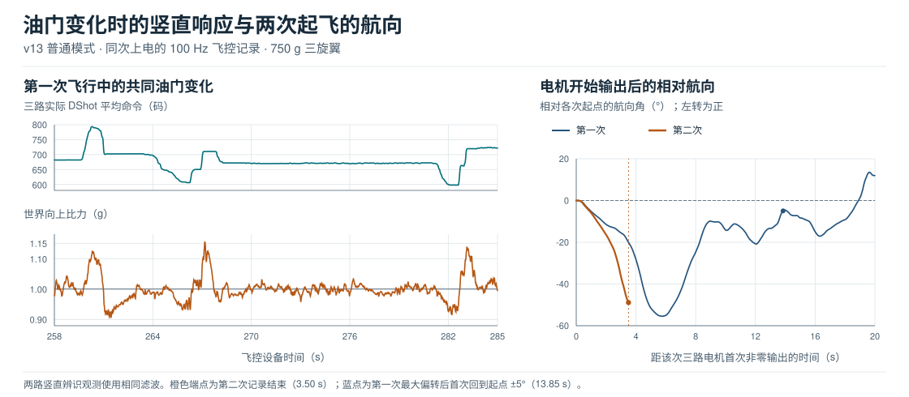

# 用机重标定悬停推力，辨识共同倾转间隙

**750 g 机体在本轮悬停点需要平均向上推力 7.3575 N。** 计入机体姿态与共同桨轴倾角，沿三支桨轴的推力大小之和约 **7.372 N**。对应接收机油门 1327 µs、三台电机平均 DShot 码 700.09。这个点可以直接作为悬停附近的物理标定依据。两次独立飞行提供了数据，检验它对其他油门点的适用程度。[可机读的标定结果](hover-thrust-calibration-20261119.json)

飞手补充三支旋翼在相同设置下方向一致，固定舵机时，输出机构仍有约 2° 的活动空间。下文采用一个共同的桨轴倾角映射，把 **2° 解释为从一侧齿面走到另一侧的总游隙**，中心两侧各约 1°。三支旋翼在固件中的输出名为 M2、M4、M3。本次拟合全部离线完成。

## 一、悬停平衡给出的标定点

取 v12 普通模式设备时间 64–124 s 的 6,000 个连续样本。现场报告空中固定油门、无风、限位绳未到限位。令向上为正，T 为窗长。对竖直方向的动量方程积分，并扣除旋翼以外的平均竖直外力，得到

\[
\overline{F_{\rm rotor,up}}=mg+m\,\frac{v_z(t_1)-v_z(t_0)}{T}-\overline{F_{\rm ext,z}}.
\]

采用窗首尾垂向速度近似相等、无显著外部竖直支撑的条件，只要求整段平均平衡，允许中间有高度波动。对每个采样时刻，将三台电机的推力方向投影到世界竖直轴，再按设备时间加权。用原推力模型分配三台之间的相对载荷，平均投影系数为 0.99804。改用三台瞬时等推力近似，总轴向推力仍为 7.37192 N，两种方法相差约 0.00005 N。

| 项目 | v12 的结果 | 能用于什么 |
| --- | ---: | --- |
| 向上推力 | 7.3575 N | 悬停时间窗的重力平衡 |
| 三台轴向推力之和 | 7.3720 N | 包含机体姿态和桨轴倾转的投影修正 |
| 单台等效轴向推力 | 2.4573 N，约 251 克力 | 三台均摊的工作点参考，差动纠姿会改变瞬时分配 |
| 电机平均码，按 M2、M4、M3 排列 | 710.77、697.98、691.51 | 三台 ESC 各自接到的工作区 |
| 合计命令的表述 | 三台平均码 700.09，归一化 0.32621 | 归一化使用 DShot 有效油门区间，与遥控脉宽分开记录 |

若质量误差为 10 g，所需向上推力变化约 0.098 N；若 60 s 窗首尾向上速度相差 +1 m/s，结果增加约 0.0125 N；额外向上支撑每增加 0.1 N，旋翼所需推力减少 0.1 N。按总游隙 2° 和相对载荷假设，仅改变共同间隙内的角度，三桨总轴向推力落在 **7.367–7.379 N**。这是几何敏感性范围。

## 二、另两次飞行能验证多少

运行版本、参数和通道来自各自封存记录。v11 先用 125 级命令量化后生成 DShot，v12 使用原生 DShot 分辨率。为比较同一物理输入，三次均以实际下发码计算归一化油门。固定 v12 悬停段求得的局部比例 **2.7913**，将它乘在原推力曲线上，预测未参与拟合的两次飞行。

| 数据用途与设备时间 | 构建 | 油门 / 三台平均 DShot | 预测向上推力 | 与 750 g 悬停条件的差 |
| --- | --- | ---: | ---: | ---: |
| 标定，64–124 s | v12 | 1327 µs / 700.09 | 7.358 N | 由标定约束给定 |
| 独立飞行 A，240–260 s | v11 | 1322 µs / 681.27 | 6.923 N | −5.91% |
| 独立飞行 B，160–209.75 s | v11 | 1317 µs / 671.11 | 6.690 N | −9.08% |

两次留出按相同机重、近似悬停检验，缺少独立测力、电池负载电压及窗首尾垂向速度。低估可能来自曲线局部斜率和不同飞行工况。把机重代入每次悬停天然会得到相近的轴向合力，不能由此推断推力曲线平坦。当前已获得一个可靠条件下的**点**，原曲线整体乘 2.7913 在留出飞行中仍有明显偏差。

**为什么 6,000 个样本足以分析姿态，却很难估总推力斜率？** 三台各自的命令标准差为 9.84、9.40、8.12 码，控制器在不断做差动纠姿。把同一时刻的三路命令取平均，其范围只有 **699.33–701.33 码**，标准差 **0.325 码**。这段数据对三路一同加油后能增加多少牛顿的约束很弱。各台的指令也只落在五点推力表相同的一个插值区间，其余节点没有被激励。

## 三、齿轮间隙能解释多少航向响应

舵机换向时，齿轮先走过空行程，再从另一侧带动三支旋翼。模型先用读回的 80 ms 舵机时间常数估算舵机位置，再转换成名义桨轴角 x。根据上一次的输出角 y 和总游隙 B，按下式更新当前输出角

\[
y_k=\min\!\big(\max(y_{k-1},\,x_k-B/2),\,x_k+B/2\big).
\]

悬停附近原标定斜率的绝对值约为 0.131°/µs，2° 全程约等于 **15 µs** 的舵机命令变化。若桨载使齿面保持贴向一侧，实际参与每次换向的游隙可以变化。按 0.50 m 力臂、7.37 N 总轴向推力估算，在近竖直位置，共同倾角每变化 1°，切向推力贡献的偏航力矩约变化 **0.064 N·m**。三支桨的局部倾角和推力接近时，三个切向水平力大体抵消，偏航力矩则同向相加。[机构标定数据](servo-tilt-calibration.json) · [齿隙模型定义](https://se.mathworks.com/help/simulink/slref/backlash.html)

在固定油门附近拟合局部方程 dr/dt = G·y + b − d·r，r 为机体 Z 轴陀螺角速度。各候选只用 v12 训练。每个验证窗由实测起始角速度和随后 0.5 s 的实际舵机命令驱动，评价窗末角速度误差。这里检验的是给定执行器命令时的动力学重放能力。以下是覆盖全部起点的 RMS，窗口互相重叠。

| 预测或重放模型 | 飞行 A（°/s） | 飞行 B（°/s） |
| --- | ---: | ---: |
| 保持起始角速度 | 9.79 | 9.75 |
| 只用衰减和常值偏置 | 8.29 | 8.83 |
| 80 ms、零游隙 | 8.38 | 8.66 |
| 80 ms、1° 总游隙 | 7.91 | 8.18 |
| **80 ms、2° 总游隙** | **7.88** | **8.13** |
| 80 ms、4° 总游隙（若现场所指为单侧 2°） | 8.67 | 8.78 |
| 320 ms、零游隙（滞后敏感性） | 7.87 | 8.18 |

80 ms、2° 模型的拟合系数为 G = 12.63 s⁻²、d = 1.00 s⁻¹、b = −35.69°/s²，角度以度输入。它在两次留出的全部 50 种窗口起始相位上均优于同滞后的零游隙模型。1° 与 2° 的整体误差仅相差约 0.04–0.05°/s，延长假设滞后也能得到几乎相同的误差。**现场观测支持采用约 2° 总游隙，飞行数据支持其有解释力，但无法独立分离游隙和舵机滞后。** 这些系数包含闭环相关性、受载机构和外扰的影响，无法直接换算成惯量或控制器增益。

## 四、横滚、俯仰及后续辨识

只用当前机体角速度和姿态角预测 0.2 s 后的同轴角速度。在 v12 训练之后固定系数。用 p、q 表示机体横滚、俯仰角速度，用 φ、θ 表示以度计的记录姿态角，训练所得的闭环局部关系为

\[
\hat p(t+0.2)=0.2262p(t)-1.9617\phi(t)-0.1578,\qquad
\hat q(t+0.2)=0.2278q(t)-1.6566\theta(t)-0.8035 .
\]

| 0.2 s 预测 RMS，横滚 / 俯仰 | 飞行 A（°/s） | 飞行 B（°/s） |
| --- | ---: | ---: |
| 保持起始角速度 | 8.80 / 9.32 | 7.18 / 7.59 |
| 固定预测零角速度 | 6.78 / 7.28 | 5.59 / 5.90 |
| 当前姿态和角速度 | **5.91 / 6.27** | **5.30 / 5.20** |
| 再加入起点已知的滤后差动电机码 | 6.64 / 6.13 | 5.25 / 5.14 |

这些数字支持当前控制模式下的短时姿态响应具有可预测性。差动码随姿态误差由反馈器产生，加入它后没有在两轴、两架次上一致改善。在小扰动滚转方程中，差动命令产生的角加速度与“力臂 × 推力斜率 ÷ 横滚惯量”成正比。若推力斜率和惯量同时增大同一倍，相同指令会产生相近的角加速度。没有独立约束时，把同一套数据拟合得更紧也不能唯一拆出二者。[NASA 关于闭环试飞数据与独立激励的研究](https://ntrs.nasa.gov/api/citations/20210018115/downloads/Morelli_Practical_FTI_Paper_v1%200706.pdf)

若要区分舵机滞后与约 2° 的空行程，可在动力关闭时独立观察输入与输出侧的换向角度和响应时间。当前缺少水平速度或位置真值，这批参数无法给出 1.5 m 游移轨迹，自旋工况也需单独验证。

## 五、v13 普通悬停试验测量共同油门与竖直推力的局部关系

**为什么还需要一轮短试验？** v12 在长悬停窗两端确有较大油门变化。下表令共同命令为三台实际 DShot 的平均码，按飞控时间取窗。先把旧记录所能提供的机体 Z 轴比力近似当作竖直比力，用质量乘比力变化估算增量。现场仅确认了中段悬停，表内的过渡窗缺少逐时刻的离地和接地标记。

| 旧记录与前、后窗（s） | 共同命令变化（码） | 机体 Z 比力变化（g） | 表观斜率（N/码） |
| --- | ---: | ---: | ---: |
| v12，[58,59) → [61,62) | +59.22 | −0.0204 | −0.00254 |
| v12，[123.5,124.5) → [125,126) | −85.90 | −0.0298 | +0.00255 |
| v11 飞行 A，[261,262) → [263.5,264.5) | −66.40 | −0.0366 | +0.00405 |
| v11 同一次收油，前窗移至 [260,261) | −65.81 | +0.0503 | −0.00562 |

v12 的加油与收油给出反号；v11 仅移动基准窗 1 s，估计也变号。已有数据足以给出悬停点，两侧的局部斜率仍待实测。

**v13 增加了哪些测量？** 波形 11 使用原生三轴加速度和相应传感器姿态计算世界向上比力，单位 g；静置时应接近 +1。波形 12 使用同一飞控周期下发的三台电机平均 DShot 码。两路均在飞控主循环中经过三个串联的 12 Hz 一阶低通，再以 100 Hz 记录；共同的滤波延迟便于比较命令和响应，也能抑制降采样前的高频振动。波形 13、14、22 分别保留传感器坐标的 AccX、AccY、AccZ，波形 23–25 保留三台实际 DShot。v13 复用原有通道数，在同一记录内提供这些观测；控制器和推力分配继续使用原有参数。本次可使用现有硬件完成。

记波形 11 的世界向上比力为 s↑，波形 12 的三台平均码为 c̄。世界向上加速度等于 (s↑ − 1) × g。取每次油门变化前后的短窗均值，代入机重 0.750 kg、重力加速度 9.81 m/s²，估算局部竖直推力斜率

\[
k_\uparrow \simeq mg\,\frac{\Delta\overline{s_\uparrow}}{\Delta\overline{\bar c}}\quad [\mathrm{N/code}].
\]

该估计要求两窗之间旋翼以外的竖直外力变化足够小。绳索受力、地面接触、明显改变的气动阻力均会进入比力；显著侧倾还会改变竖直投影。后续若有带载电压或独立高度观测，可用来解释跨电池差异和垂向运动。

**飞手操作和验收。** 在普通模式空中稳住，S1 回中。围绕当次悬停油门，小幅加油约 1 s、回到悬停，再小幅收油约 1 s、回到悬停。空间允许时重复一次，共得到两次加油和两次收油。保留必要的人工纠偏，落地后说明哪段全程离地，是否有绳索受力或明显升降。分析时先核对地面静置的 +1 g、样本连续性、姿态和三路输出，再分别比较加油、收油的斜率。平台时间依据油门与实际命令选定，随后逐组留出检验重复性。若改换合理取窗即反号、各组方向不一致或加速度变化接近悬停噪声，则保留悬停点并报告局部斜率的不确定性。

**本架次起飞前实测。** v13 已经 RemoteMCU 下载并核对新启动编号 2607357466。记录 `18e96d8206be4068-34` 内已完整回读 112 项参数，与 v12 的固定油门悬停记录逐项相同。普通模式、航向外环 0.80 s⁻¹、电机 40 ms、舵机 80 ms、俯仰配平 −0.5°、方向激光使能和自旋关闭均已核对。静置 3 s 的 301 点连续，竖直比力均值 0.9982 g，标准差 0.00064 g，三路 DShot 均为零。该窗飞控周期为 500 µs，截至窗末累计无超期。

## 六、v13 实测结果与完全松绳后的右后漂

首轮油门动作均在空中完成，顶部细绳有轻微拉力。飞手确认，另一次把绳完全放松后，飞机持续向机头右后方移动，撞到物体，随后在仍给油门、未主动切 SA 的情况下停转。机体坐标为 X 向前、Y 向左、Z 向上，因此右后方为 −X、−Y。连续波形覆盖第一段完整动力输出和第二次启动的前 3.50 s。漂移方向和碰撞先后来自现场观察，记录中缺少碰撞时刻的连续波形和对地速度。

记录 `18e96d8206be4068-34` 含 28,958 帧、28,086 个波形样本。所有帧通过 CRC，主机写盘丢帧为零。唯一缺失的 100 Hz 样本在 288.277–288.297 s，位于第一段电机命令归零之后。首轮两个油门操作区数据连续。244–285 s 主循环记录值均为 500 µs，记录内累计最大工作时间为 304 µs，超期计数为零。主机在收到首段停机反馈后封存了文件，末样为设备时间 346.397 s。同一启动后续只补回了电机事件和设备状态。

### 油门与竖直力

下表用 0.750 kg 乘以世界向上比力的变化。表内是整机所受竖直非重力合力的增量。绳的拉力若保持恒定，会在两窗相减时抵消。此次没有张力计，任何变化的竖直绳力都会进入结果。悬停锚点 7.36 N 对应由旋翼独自承担 750 g 重量的条件，不能把这轮有绳飞行也当成独立测力标定。

| 操作及设备时间（s） | 三台平均 DShot 变化 | 竖直力变化 | 解读 |
| --- | ---: | ---: | --- |
| 259.15–259.70 → 261.25–261.80 | +20.14 码 | −0.467 N | 两窗之间曾冲到约 794 码再回落，端点差混入过渡响应 |
| 267.30–267.85 → 268.25–268.80 | −38.43 码 | −0.424 N | 收油方向一致，力差小于两个平台内部的波动尺度之和 |
| 280.80–281.35 → 282.05–282.60 | −72.77 码 | −0.458 N | 这次减油对应约 0.00629 N/码 |
| 282.05–282.60 → 283.30–283.85 | +122.08 码 | +0.837 N | 回加对应约 0.00686 N/码，与上一行共用低油门段 |

平台按操纵输入和实际电机命令选取。前三对各自独立，逐对留出预测的相对均方根误差为 **171%**。最后两行说明同一次收、加油动作中指令与力的变化方向一致。把最后一段高油门取窗向后移至 284.0–284.5 s，均值仍约为 723 码，竖直比力已回落，所得斜率进一步变小。现阶段可用这些数据验证瞬态模型，单一候选斜率还不能写入五点推力表。

在 244–259 s 与 269–281 s 两个相对平稳的窗口，用三轴加速度和姿态离线重建向上比力，与机载低通的平均值分别相差约 0.0027 g 和 0.0003 g。首段起飞前与停机后的静置均值相差约 0.00024 g。这些比较检验了投影符号、量级与低通输出的一致性，两种计算共用同一只 IMU。

### 右后漂的方向与起动航向

第二次电机开始输出后，记录覆盖 342.895–346.397 s。Roll、Pitch、Yaw 杆都在死区，S1 回中。末 1.39 s 内，机身平均右倾 0.79°、后仰 0.75°。按每个样本当时的机头方向投影，IMU 估算的水平加速度均值约向右 0.23 m/s²、向后 0.04 m/s²。右向分量比后向分量更清楚。1° 姿态误差就可在水平加速度估计中引入约 0.17 m/s²。该窗跨越起飞过渡，100 Hz 三轴记录还含振动，无高度或地速测量。

起动本身存在可重复的航向变化。首次电机开始输出后约 5.76 s 内，航向估计顺时针变化约 55°，到起动后约 13.85 s 首次回到起始航向 ±5°。第二次在 3.50 s 内顺时针变化约 49°。第二段末航向环已要求反向 20°/s，达到当前限幅，舵机指令从约 1483 走到 1450 µs。舵机命令能验证控制器已纠偏，实际受载倾角和电机反扭矩仍需单独判断。转动中“当时机头的右方”和“起飞点固定方向”会随时间分开，不能从末段姿态均值还原持续漂移轨迹。

绳有轻微拉力时，偏离中心可带来水平回拉。完全松绳后单向漂移的观察符合少了回拉的解释，但不能由两次观察唯一确定偏移来源。起飞时已有水平速度、机架姿态配平、三台实际合推力方向与机架的夹角均是可区分的候选。现有普通模式控制姿态，给定参数中含 −0.5° 后仰配平；若推力轴垂直于机架、姿态准确跟随，该项单独对应约 0.086 m/s² 向后加速度，仍解释不了右向分量。在动力关闭、机架找平后，可直接测三台桨轴相对机架的前后和左右倾角，尤其检查悬停舵位下从两侧接近时的重复性。三个齿轮端角度一致并不能排除相同方向的安装偏差。[姿态模式与地面漂移的说明](https://docs.px4.io/main/en/flight_modes/manual_stabilized_mc)

### 封存后的两次切停

同一启动编号下，与飞手所述带油门停转最吻合的是 **368.736 s 的第 12 号事件**。第二段从 342.895 s 开始输出动力，到该事件时最近通道缓存仍为 SA 1000 µs（解锁位）、油门 1311 µs，飞控撤销解锁，三路电调命令同时归零。直到 375.352 s 才记录到 SA 2000 µs（停机位）。第三段从 387.204 s 到 405.509 s，末端油门为 1033 µs，三路先随低油门归零。406.849 s 的第 18 号事件撤销解锁，比三路归零晚约 1.34 s。414.242 s 再次观察到 SA 2000 µs、油门 1000 µs、停机。

设备时间 499.949 s 的同一启动状态保留两次控制故障、16 个加速度计碰量程样本和零次循环超期。最后一次控制故障发生于 406.848596 s，锁存的 IMU 原因为加速度计碰量程，与第 18 号事件在同一 500 µs 周期内。第 12 号事件缺少同刻的首个故障原因。`rc_ok` 同时受遥控链路、准备条件和飞控故障影响，`fault` 仅指 DShot 驱动层。现有记录无法判定碰撞后首先触发了哪项保护。

飞手观察到右后漂出现在碰撞之前。下一步优先核对起飞时的航向偏转和三台桨轴相对机架水平面的倾向。为给机构测量提供参照，首轮两个平稳窗口（244–259 s、269–281 s）的舵机命令中位数分别为 1458 和 1463 µs，均在约 1460 µs 附近。这是实际悬停时的命令参考，桨轴角度仍需在机构输出侧测量。保护阈值与飞行配平沿用本轮设置。

补录依据包括同一启动的电机边沿原文和最后一次设备状态的原始计数。事件文字中的 `us32` 是量测时间，单位为微秒。[事件与诊断数据摘录](hover-v13-postflight-events-20261119.json)

## 七、断电测量三台桨轴的前后与左右倾角

这项测量检验三台电机的轴线是否存在共同向右后方的偏差。量的是从电机中心沿桨轴指向上方的方向。桨叶有自身的桨距和扭转，不能用叶片表面代替轴线。

先记录原始读数再作调整。碰撞可能改变桨座或机臂的几何位置，这批读数代表当前状态；若有换件或重新紧固，请在记录表旁注明。

1. **先保留碰撞后的原位。** 拔下动力电池和 USB，保持整机断电。先看桨轴、桨座、机臂和齿轮固定处有无弯曲、松动或裂纹，异常处先记录。把机架放在硬台上，垫中央刚性平板，用水平仪沿前后、左右分别找平，记录剩余倾角。把机头标作“前”，从机尾朝机头看，左手侧标作“左”。俯视时 M2 在左前、M4 在右前、M3 在正后。
2. **标记机构位置。** 在公共机构的活动件和旁边的固定件上各贴一小段胶带，画一对对齐线。已有经过确认的 1460 µs 机械刻线、且当前与之对齐，便记“1460 刻线”。其余情况记“断电原位，PWM 未知”。保持该位置测完三台，中途复核对齐线。拔电后旋钮或网页数字都不能证明舵机当前位置；用手反拧舵机或扳动机臂会改变测量条件。
3. **把轴线延长。** 用能同轴套在电机轴或桨座定位圆柱上的轻质直杆，尽量留约 100 mm 可见跨度，选中心线上的上、下两点。叶片碍事时在断电后拆桨。工装应能自行保持位置，避免侧向推力吃掉齿隙。在同一电机上把工装绕轴换向 180° 再读一次。若倾向明显跟着直杆翻转，先检查工装同轴性，并保留两次读数。
4. **读前后、左右两个方向。** 在直杆旁挂一根带小重物的细线作为铅垂线，直尺与杆放在相近深度。从机体正侧方平视，量出两点的垂直高度差 H，以及上点相对下点向前或向后的水平偏移。再从机尾沿机头方向平视，量上点向左或向右的偏移。需要拍照读尺时，让镜头正对当前测量平面并对准杆的中段，画面内保留铅垂线、直尺、方向标签。测完 M2 再换 M4、M3，最后复查机架水平和公共机构标记。
5. **按实测填写。** 可直接填“后 2 mm、左 1 mm”。上点向前、向左分别记为正，向后、向右记为负。H 是两点的垂直高度差。若量角工具能直接读取轴线相对铅垂的两个投影角，也可填带方向的度数。每台保留两次读数。

| 电机 | 机构位置及量具 | H（mm） | 前／后偏移或角度，第 1／2 次 | 左／右偏移或角度，第 1／2 次 |
| --- | --- | ---: | --- | --- |
| M2 左前 | | | | |
| M4 右前 | | | | |
| M3 正后 | | | | |

可选的精确定位仅适用于手头有能显示脉宽的独立舵机测试器、且舵机三芯线可完整拔离机上供电与信号线路的情况。在整机电池与 USB 均断开的条件下，单独给测试器和舵机接舵机额定电源。移开工装与手，先从 1440 µs 升至 1460 µs，停稳后测三台。移开工装，再从 1480 µs 降到 1460 µs 重测。把两张表分别标注“由低到达”和“由高到达”。这测的是相同命令从两个方向到达时的输出差，和工装换向的重复读数分别记录。没有此设备，断电原位的表已经可以用于初筛。

用每个方向的水平偏移除以 H，再取反正切，即为该方向相对铅垂的投影倾角。H 为 100 mm 时，偏 1 mm 约为 0.57°。旧表在 1460 µs 时给出约 +3.04° 的共同切向倾角。换算成机体系，名义值为 M2 后 2.63°、左 1.52°，M4 前 2.63°、左 1.52°，M3 前后 0°、右 3.04°。这三种不同朝向来自 120° 机构布局，等推力时名义水平分量相抵。判读时先考虑各自的名义方向，再比较实测偏差的合成方向、重复性和齿隙。一次无载测量可发现安装倾向，判定飞行中的实际推力方向还需考虑受载变形和三台推力差。[本机角度标定表](servo-tilt-calibration.json) · [直角三角形的角度换算](https://www.usgs.gov/educational-resources/determine-percent-slope-and-angle-slope)

## 离线复算

以下命令使用 Python 3 和 NumPy 2。将环境变量 LOGS 设为含三份封存记录和同名 JSON 元数据的目录。工具验证构建版本、CRC、波形连续性和对应参数读回。

~~~sh
python3 tools/cyclone/calibrate_hover_thrust.py "$LOGS"
python3 tools/cyclone/fit_hover_yaw.py "$LOGS"
python3 tools/cyclone/fit_hover_yaw.py "$LOGS" --assumed-servo-lag-s 0.32
python3 tools/cyclone/fit_hover_transverse.py \
  --train "$LOGS/18e969bdb4687f80-24.rmplog" 64 124 \
  --validate "$LOGS/18e96796850df0e0-15.rmplog" 240 260 \
  --validate "$LOGS/18e9684085984998-18.rmplog" 160 209.75
~~~

v13 主分析命令如下。第二对以较低码的平台为参考，表中则按实际时间先后写作收油。第四行的回加与第三行共用窗口，应单独运行。主记录 SHA-256 为 `9367282c09c9b6b8140d89ad49ba438d803f41a16323a623c9acbccb71368f31`。

~~~sh
python3 tools/cyclone/fit_collective_slope.py "$LOGS/18e96d8206be4068-34.rmplog" \
  --pair up 259.15 259.70 261.25 261.80 \
  --pair up 268.25 268.80 267.30 267.85 \
  --pair down 280.80 281.35 282.05 282.60
python3 tools/cyclone/fit_collective_slope.py "$LOGS/18e96d8206be4068-34.rmplog" \
  --pair up 282.05 282.60 283.30 283.85
~~~

本架次飞控沿用 v12 的执行器曲线。[v12 原始反馈与控制审计](reports/cyclone-v12-hover-audit-20261119.html)
