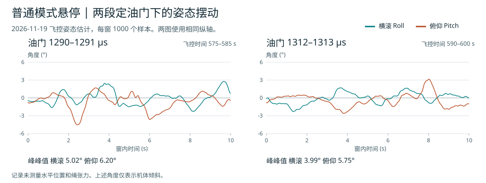

# 普通模式悬停摆动、撞击与停机后单电机转动复核

2026-11-19 · 实飞固件 v8／v9 · 离线修订 v10

**维修决策。** 停机后移动飞机时有一只电机突然转动，属于单独的动力安全故障。v9 确有解锁互锁薄弱点。撞击后现存记录里三路电机命令均为零，但报告事件的确切时刻、电调端收到的帧和轴转速均缺失。先修复并验证解锁通路、隔离检查电调与线束，再恢复飞行。前飘与往返摆动分别调查，一次固定配平只能抵消平均偏差。

## 电机在什么时候停了

| v9 飞控时间 | 记录 |
| --- | --- |
| 638.259832 s | 最后一个带动力的波形样本。飞手报告摆幅过大，机翼碰到物体。精确接触时刻未经独立测量。 |
| 638.262095 s | 首次控制故障锁存，原因是加速度计达到 ±8 g 量程边界。此前的摆动已经出现在记录中。 |
| 638.270317–681.940319 s | 连续 4,368 个 100 Hz 样本，M2、M3、M4 的飞控端命令全为 0。该段解锁状态快照全为停机，机体被移动，Z 轴角速度绝对值最高 215.78°/s。 |
| 文件结束以后 | 同次启动的后续状态显示加速度触顶与控制故障计数继续增加，缺少相应时间段的电机波形和用户目击事件的对时。 |

三路单向 DShot 波形描述飞控端命令。驱动检测到时序或引脚异常也会将本机记录值置零。即使飞控记录为零，仍须检查电调输入端能否解码出有效的停止帧。过去的 100 Hz 记录还可能漏掉 10 ms 间隔中的短暂命令。协议的零值含义与帧格式见 [Betaflight DShot 文档](https://betaflight.com/docs/development/API/Dshot)。

## v10 修了什么

本机安装的 CRSFforArduino 2025.12.11 在收完一个候选帧时会触发通道回调和链接保活。校验失败、其他帧类型或地址不符时，上次成功解出的摇杆值仍可能被回调。v9 的另一处问题是 SA 只要有一帧落在 1500 µs 以下，在低油门和其他许可均满足时就能解锁。静止于真正的停机位且油门最低时，旧代码按设计会给三路下发零。两个薄弱点都需要修复，目前无法证明事故中恰好发生了其中任何一个。

v10 在当前接收机通路分别校验设备地址、类型、长度和 CRC。只有新的完整 16 通道数据帧才更新控制值和通道保活时间。链路质量帧另行处理，300 ms 没有有效通道更新会撤销控制权。操作者先在明确的 SA 停机档（≥1700 µs）、油门 ≤1040 µs、S1 回中的条件下准备。然后拨至解锁档（≤1300 µs），在低油门、中 S1 条件下至少收到 3 个有效通道帧，跨度至少 150 ms，相邻确认帧间隔不超过 100 ms。已解锁时一帧离开解锁区即切断，重新解锁须再经过明确的停机档。输出端还检查接收机原始油门、SA 和解锁状态。[TBS 的 CRSF 帧和 CRC 定义](https://github.com/tbs-fpv/tbs-crsf-spec/blob/main/crsf.md)

新解锁还要求最近 3 s 内收到过合格的链路质量报告。已解锁飞行中，单独缺失统计报告不会切动力；收到明确的坏链路报告或通道帧超时则会切断。在动力断开的台架上，先确认实际接收机能持续识别、六个通道方向与旧固件一致，再核验切停路径。

新增的 RemoteMCU 设备日志在每次 DShot 发送后检测状态变化，可捕捉相邻波形之间短至一个主循环的事件。正常飞行记录三路从全停到有输出及反向的变化，停机时逐路检测是否出现非零输出。每条保留原始 SA 和油门、解锁标志、驱动故障、引脚异常位及本地驱动的三路电机命令。`us32` 是事件发生时的 32 位微秒计数（约 71.6 分钟回卷），帧时间是发送时刻。最多缓冲最近 16 条，`lost` 标明本次上电以来被覆盖的数量。短时断开 USB 后可补发尚在缓存内的事件，断电会清空缓存。每次主循环只记边沿。串口格式化与发送由原有非阻塞遥测调度完成，事件发送上限为每秒 20 条。维修后还需在真板核验实时余量和电调端波形。

## 前飘、往返摆动与航向

两份 RMPLOG 均通过逐帧 CRC 核验。v8 有 29,022 个波形样本，v9 有 16,117 个，两份记录的源序号均无缺样。以下时刻以相应固件启动的源时钟计。没有独立的离地开关或地面位置传感器，电机有输出的区间可能包含地面阶段。

| 现象 | 可从记录确认的事实 | 对维修的意义 |
| --- | --- | --- |
| 沿机头前飘 | v8 两段动力窗口 Pitch 均值约 −0.18°、−0.09°，飞手观察到向机头方向漂移。按共用倾角表重放电机命令，未预测持续向前的水平合推力。 | 检查三台电机各自真实轴线、共同传动的回差及推力差。机架水平只确定 IMU 的参考平面。 |
| 加 −0.5° 配平后 | v9 中杆窗口估计 Pitch 均值 −0.583°、Roll 均值 −0.063°。没有实测水平速度或位置轨迹。 | 配平已反映在姿态上；此次碰撞试验无法量化它抵消了多少前漂。暂不据此增加后仰量。 |
| 固定油门仍来回摆 | 见下表。两个 10 s 窗中横滚频谱主峰均约 0.30 Hz，约 3.3 s 一次。飞手观察到加油门后位置摆幅增大。 | 姿态数据支持低频变化。这两小段的角度峰峰值随油门上升略降，空间摆幅需要视频或位置传感器独立测量。 |
| 航向保持 | v9 中杆窗口航向参考固定，575.21 s 估计误差绝对值约 60.7°，590–600 s 窗内峰值约 19.1°。v8 也有早期较大偏差和后期较平稳时段。 | 六轴 IMU 提供相对航向；用机头标记或俯视视频核对真实旋转及离地阶段，再评估航向环。 |
| 普通模式激光 | v9 在 570–636 s 的每个状态快照都为已解锁、激光输出高。 | 用户实际看到的光斑还取决于模块供电、控制接线与安装。拆桨台架同步观察 GPIO14 和光斑。 |

| v9 源时间 | 样本数 | 油门 | Roll 峰峰值 | Pitch 峰峰值 |
| --- | ---: | ---: | ---: | ---: |
| 575–585 s | 1,000 | 1290–1291 µs | 5.02° | 6.20° |
| 590–600 s | 1,000 | 1312–1313 µs | 3.99° | 5.75° |



峰峰值取窗口内原始角度最大值减最小值。横滚频谱先去线性趋势，再加 Hann 窗，10 s 窗对应约 0.1 Hz 的频率间隔。另一个 615–630 s 窗口的横滚峰峰值增至 10.86°，期间油门在 1240–1362 µs 变化，不能与前两段作为等条件对照。

## 约 50 克力的挂绳能解释多少

按现场估计，张力约 0.49 N，相当于 750 g 机体重量的 6.7%。绳与竖直方向夹角为 α 时，水平拉力大小为 T sin α。若张力保持 0.49 N，绳偏离竖直 10° 时水平力约 0.085 N，对应整机水平加速度约 0.11 m/s²。拉力作用在重心上方时还会产生姿态力矩。这个算例只说明量级，试飞中并没有测到这 10° 的绳角。

固定的机体轴偏差倾向于造成同向的平均推力；反复换向还要考虑绳方向变化、姿态反馈、外界扰动和机体已有的水平速度。飞控闭环控制机身倾角和航向，未闭环控制水平位置。复飞时同步记录带比例尺的俯视视频，侧视画面记录绳子何时拉紧及摆向。将机头、绳角、机体位置与 Roll／Pitch／Yaw、舵机和电机命令对时，才能分辨哪一项先变化。

## 维修后怎样判定可以恢复测试

1. **断开动力电池并拆下全部桨。** 检查受撞侧桨座、电机轴、倾转支座、齿轮、飞控固定，检查电调信号线及地线、端子退针、破皮和焊点。若能辨认，记录猛转的是 M2 左前、M4 右前还是 M3 后电机。
2. **先只给飞控和接收机供电。** 更新 v10 后，用 RemoteMCU 核对固件标识、开始记录。SA 停机时拨动其他通道、移动机架，核对三路命令和解锁事件。分别验证正常解锁／切停、接收机断连／重连和上电时 SA 已在解锁位的情况；故障恢复后验证新的停机→解锁顺序。测量主循环仍为 500 µs，核对超周期计数及最大工作耗时。
3. **验证电调收到的信号。** 由检修人员在拆桨固定的台架上，用逻辑分析仪在电调信号端对该电调的信号地取样，对照飞控端和事件时间。停机应持续收到三路有效 DShot 0。若电调端出现非零推力帧，从飞控输出向线束逐段比对。若帧缺失或校验异常，检查信号／接地和驱动故障；若确认电调端持续收到有效 0 且电机确有转动，单独隔离该电调、电源和电机。未经独立检查的动力通路不用于复飞。
4. **测量实际旋翼轴。** 机架找平、动力隔离，量每台电机在估计零位和悬停舵机范围的前后、左右偏角及回差。先校正有可重复偏差的支座或联动件，复测后才把残差带入模型。[三路推力轴测量表](CYCLONE_ROTOR_AXIS_CHECK_20261119.md)
5. **普通模式先复测。** 动力停机验收通过后，从已记录的参数基准对照，每次只改一项。固定相机和地面标线测机头方向位移，标记离地、收油和绳子张紧的时刻。普通悬停的往返摆动与航向经独立核对后再评价自旋。

## 数据索引

维修候选固件为 `drehm-cyclone-rotor-v10-arm-guard-20261119`。Teensy 4.0 USB Serial 构建完成，HEX 文件 SHA-256 为 `1b049e0676bf709e34635d3ced15955ab68385c9fea90773375f9ad526a355d9`。离线工件位于 `build/cyclone-v10-arm-guard-20261119/dRehmFlight_Teensy_BETA_1.3.ino.hex`。飞控在维修期间保持离线，尚待拆桨下载、实测接收链路及电调信号。

软件回归覆盖坏 CRC、错地址、过短或带扩展字段的帧、通道超时、SA 中间档、解锁等待期间油门或 S1 被移动，以及时间计数回卷。事件记录测试覆盖两个波形样本间的单路短促输出、驱动故障、USB 阻塞和缓存覆盖。RemoteMCU 应用配置通过离线校验，沿用原有 32 路波形和 59 项状态。

原始数据目录为 `build/cyclone-v8-normal-hover-20261119/` 和 `build/cyclone-v9-pitch-trim-20261119/`。v8 记录 ID 为 `18e957d85cef5310-16`，boot 为 `1927356495`。v9 记录 ID 为 `18e958db3edf0e48-0`，boot 为 `2271540567`，SHA-256 为 `0b61996577d41dcb97a18d3d88ba5d7aaec22d652ee8a5e0f67f89b740107231`。历史记录和其构建版本配套读取。取 v9 首个定油门窗口的命令如下。

```sh
python3 tools/cyclone/inspect_recording.py build/cyclone-v9-pitch-trim-20261119/flight.rmplog \
  --metadata build/cyclone-v9-pitch-trim-20261119/metadata.json \
  --boot 2271540567 --start 575 --end 585
```
