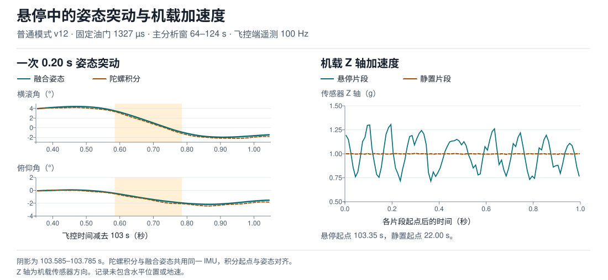

# 普通三旋翼悬停复核：姿态突动、水平游移与推力模型

2026-11-19 · v12 · 普通模式 · 固定油门 60 秒

这次没有再出现此前从中心向右移动 1–2 m 后返回的周期轨迹。飞手报告现场无风，限位绳未触发，机体偶尔抖一下，在约 1.5 m 半径内无规律游移。记录证实了短时姿态突动，也暴露出一个更基础的问题：悬停时，现用模型从电机命令算出的平均向上推力只有 **2.636 N**，750 g 整机的重量为 **7.358 N**。在限位绳没有显著承重、平均高度近似稳定的条件下，这套推力曲线严重低估了悬停工作点。当前数据足以检验软件计算和部分动力学假设，尚不足以逐次归因抖动或复原对地轨迹。

## 1. 遥控输入、采样和时间基准

封存记录 `18e969bdb4687f80-24`，启动号 `3849515501`，SHA-256 为 `4828cfe4edb7f4ea2ac5fd5e094d301f0a2d2cc690b11606f22e39048b7d44af`。按同一次启动的设备时间排序。主分析窗为 [64, 124) s，其中 6,000 个样本从 64.004837 到 123.994837 s。静置参照为起飞前 22–32 s。它只用于测噪声底，未假定地面已经找平。

| 核查项 | 实测 | 判断 |
| --- | --- | --- |
| 文件与连续性 | 16,160 帧 CRC 全部通过，15,638 个波形序号连续，重复、记录器丢帧均为 0 | 可按飞控时间分析事件先后 |
| 控制周期 | 记录的周期均为 500 µs，板上累计最大周期 500 µs，累计最大工作耗时 304 µs，超周期 0 | 此轮未发现主循环被遥测打乱 |
| 波形发送间隔 | 中位 10.000 ms，范围 8.000–11.504 ms | 波形是约 100 Hz 的快照。积分按实测时间间隔计算 |
| 固定油门段原始通道 | 油门恒为 1327 µs，Roll、S1 均为 1503 µs，Pitch 为 1500 或 1502 µs，Yaw 为 1500 µs | 水平操纵与航向操纵全在死区，自旋关闭 |
| 运行参数 | 同一记录内两次完整的 112 项读回，版本均为 2。航向增益 0.80，电机/舵机时间常数 40/80 ms，俯仰配平 −0.5° | 按该次实际读回核算。60 个状态快照均显示使用初始物理模型、物理模型未经标定验收 |
| 健康计数 | IMU 读失败、全零帧、加速度和陀螺顶格、融合失败、控制故障均为 0 | 未发现这些故障引发可见突动 |

## 2. 抖动在反馈里是什么样子

把机体系三轴陀螺按当时姿态转换成欧拉角变化率，再按设备时间积分，与融合姿态的增量逐窗比较。0.5 s 窗的横滚、俯仰、航向相关分别为 **0.9957、0.9948、0.99998**，差值 RMS 为 **0.205°、0.154°、0.035°**。两条路径共用 IMU，足以检验短时符号、轴变换和估计连续性。绝对航向、安装误差和载荷振动下的真实姿态仍缺独立参照。



| 设备时间 | 实测事件 | 同期的控制或反馈 |
| --- | --- | --- |
| 93.535 s 起的约 0.20 s | 横滚变化 −3.54°，俯仰变化 −2.84° | 两轴同时发生短时角运动 |
| 100.445 s | 航向率 −48.1°/s，目标 +2.0°/s | 滤后反馈 −45.5°/s，控制器请求 +0.115 N·m 纠偏。当时横滚、俯仰仅 +0.14°、+0.16° |
| 103.585 s 起的约 0.20 s | 横滚变化 −4.41°，俯仰变化 −1.49° | 两轴合成变化 4.66°，是本窗最大值。全部 0.2 s 滑窗的中位数 0.93°，99 分位 3.80° |
| 115.055 s | 机体横滚、俯仰合成角速度峰值 28.64°/s | 航向率仅 −2.1°/s，前后各 0.1 s 的舵机命令范围仅 1 µs |

这些时间点是从波形选出的事件，与飞手感觉到抖动的具体时刻没有同步标注。60 s 内横滚、俯仰均值为 −0.03°、−0.51°，标准差为 1.61°、1.23°。姿态均值接近目标，仍会在短时间偏离。相对航向误差 RMS 为 **13.40°**，最大 **30.10°**。横向突动和航向突动可以分开发生。

## 3. 哪些滤波行为已经核实

在 2 kHz 上，陀螺和加速度软件一阶低通的系数分别为 0.10、0.14，对应约 33.6、48.1 Hz 的 −3 dB 频率，低频群延迟约 4.50、3.07 ms。航向率 PI 另用 12 Hz 低通。Welch 频谱采用 10 s 窗、线性去趋势、Hann 窗、50% 重叠，按名义 100 Hz 对连续序列估计频带能量。频谱用于描述回传波形。

- **低频反馈一致。** 在 0.5–2 Hz，航向率滤后与滤前的频带 RMS 比为 0.998。该频段的转动基本传入了控制器。
- **带动力时机载加速度波动显著。** 传感器 Z 轴静置标准差为 0.00183 g，固定油门时为 0.15768 g，均值为 0.99516 g。后者同时含机架振动与飞行动加速度。融合器在三轴加速度模长超出 0.8–1.2 g 时只做陀螺传播；6,000 个记录点中有 603 个仅 Z 分量就超过 1.2 g。10.05% 是所记录快照中可确认跳过重力修正的下限，完整 2 kHz 占比未知。
- **现有高频波形有混叠迹象。** 表观 5–15 Hz 的 Z 轴 RMS 达 0.138 g。航向率滤后/滤前的同带比仅 0.298，而 12 Hz 机内滤波器对真正位于这一带的单频输入，理论幅比约 0.62–0.92。遥测抽取当前循环值，没有专为降至 100 Hz 配置的抗混叠滤波。采样时序和带外能量都影响估计，现有峰值不宜用来指定陷波频率或识别哪台电机。0.2 s 滑窗内，Z 轴标准差与合成倾角变化量的同时相关约 −0.09，单看 Z 轴振幅也解释不了每次突动。

MPU6050 路径检查 14 字节读取和量程寄存器，初始化依赖芯片复位后的 DLPF 与采样分频设置。固件设 I²C 为 1 MHz，器件标称上限为 400 kHz。此轮读失败为零；当前日志未读回 DLPF/分频配置，也未记录逐轴新样本标志。器件加速度更新率为 1 kHz，2 kHz 控制循环可能两次读到同一份值。若调整总线或滤波设置，需要同时复核数据新鲜度和 500 µs 周期预算。[TDK 寄存器手册](https://invensense.tdk.com/wp-content/uploads/2015/02/MPU-6000-Register-Map.pdf) · [TDK 器件规格](https://invensense.tdk.com/wp-www.invensense.com/wp-content/uploads/2015/02/MPU-6000-Datasheet1.pdf) · [PX4 振动频谱与滤波延迟](https://docs.px4.io/main/en/config_mc/filter_tuning)

## 4. 从姿态误差复算控制量，再从命令反算分配

用读回参数重放机体推力轴与目标推力轴的夹角、陀螺阻尼、积分随航向的坐标旋转，以及电机混控在悬停工作区的局部推力斜率。横滚和俯仰只在窗口首帧通过需求力矩反算未回传的两个积分初值，后续约 60 s 独立传播。航向角速度目标包含 20°/s 限幅和 30°/s² 斜率限制。航向 PI 使用已记录的滤后率和积分核算，逐个 500 µs 周期的抗饱和动作未独立重放。

| 检查量 | 横滚 | 俯仰 | 航向 |
| --- | ---: | ---: | ---: |
| 飞控需求力矩 RMS（N·m） | 0.02628 | 0.02412 | 0.05912 |
| 离线控制律与需求力矩的 RMS 差（N·m） | 0.000022 | 0.000021 | 0.0000016 |
| 用三路 DShot 码、舵机 PWM 和静态模型重建力矩，与需求的 RMS 差（N·m） | 0.00049 | 0.00050 | 0.00087 |

航向率目标重放的 RMS 差为 0.000086°/s。加入电机 40 ms、舵机 80 ms 的一阶滞后后，离线与机载预测航向力矩的 RMS 差为 0.00030 N·m。60 个约 1 Hz 的状态快照中，升力及横向力矩分配系数均为 1。35 个报告航向分配受限，固件保持舵角期间的微小残差也会置该位，因此不能把它解读为 35 次机械打限位。以上检查支持这组输入下的软件轴向、单位和控制运算，电调推力和舵机真实角度仍需独立验证。

同一航向增益 0.80 下的历史对照如下。v11 的固定油门为 1322 µs，v12 为 1327 µs，各取 20 s。每行是一段实飞，不是同一阵扰动的重复试验。

| 版本与窗口 | M2/M4/M3 不同码值数 | Z 轴标准差（g） | 0.2 s 合成倾角变化 99 分位 | 航向误差 RMS |
| --- | --- | ---: | ---: | ---: |
| v11，240–260 s | 5/5/4 | 0.165 | 4.26° | 8.92° |
| v12，80–100 s | 56/60/53 | 0.160 | 3.69° | 17.05° |
| v12，100–120 s | 54/55/44 | 0.157 | 4.04° | 13.47° |

v12 已实际下发相邻的一计数命令。飞手报告本轮固定向右往返消失。短时倾角变化和 Z 轴波动同量级，两个 v12 窗口的航向误差均更大。单次对照不足以将轨迹变化全部归功于 DShot 修正。

## 5. 实机对动力学模型的检验

**竖直力平衡。** 将三路 DShot 经各自五点推力表换算为牛顿，用舵机倾角表和机体姿态投影到世界竖直方向。当前表来自推重比和推力随命令平方变化的假设。64–124 s 的平均机体 Z 向推力为 2.638 N，投影到世界向上是 **2.636 N**。这仅为机重的 **35.8%**，差约 **4.72 N**。姿态投影只改变约 0.002 N。这个悬停点约束三台电机推力之和，无法确定三条推力曲线的各自斜率，更不适合把整张表乘以 2.79 后直接飞行。[初始模型参数来源](YAW_FIRST_FLIGHT.md)

**角动量平衡。** 用机体系估算力矩、读回的三轴惯量及陀螺耦合项预测角速度增量，再与同窗实测陀螺首尾作差比较。半秒窗重叠，因此相关系数是描述量，不用这些窗数计算统计显著性。

| 约 0.5 s 内的角速度变化 | 横滚 | 俯仰 | 偏航 |
| --- | ---: | ---: | ---: |
| 模型预测均值（°/s） | +14.77 | −15.99 | +24.58 |
| 陀螺实测均值（°/s） | +0.032 | +0.045 | +0.062 |
| 预测与实测相关系数 | 0.454 | 0.395 | 0.425 |

航向平均需求力矩为 +0.05353 N·m，其中 +0.05217 N·m 来自积分，约占 **97.5%**。这说明系统长期需要同方向的配平命令。模型把这部分解释为持续加速，实机却没有积累对应的角速度。刚体力和力矩平衡的方程适用；目前配置的执行器推力、三臂轴线、反扭矩与外扰模型组合无法预测本轮实机。即使忽略恒定偏置，半秒增量的相关性仍有限，也不能仅通过修正一个静态系数解决动态问题。

**共同倾转机构。** 舵机命令实际只覆盖 1441–1483 µs，中位为 1462 µs。整个工作区位于原始标定的 1327 与 1605 µs 两点之间。M3 有静态实测，M2/M4 按共用齿轮复用同一张表。当前模型中三臂切向分力大体相抵，直接机体水平推力幅值的 95 分位仅 0.007 N。这个小数对“三臂轴线一致”的假设非常敏感，无法排除你指出的装配偏角、回差或受载变形。机体水平加速度、各旋翼实际角度、转速与电池电压均未进入本次波形。[机构原始标定](servo-tilt-calibration.json)

## 6. 对 1.5 m 游移的解释与验证顺序

普通模式把中杆变成目标姿态，俯仰还带 −0.5° 配平。当前闭环没有水平位置或地速误差输入。即使无风，持续倾斜 1°，在推力近似平衡重量时也可产生约 0.17 m/s² 的水平加速度；姿态恢复水平后，先前积累的水平速度仍可带着飞机移动。这能说明无风游移的机制，无法由此计算本次走了多远。**1.5 m 是现场观察的半径。** 航向摆动还会改变机体倾斜投影到地面的方向。原地定点能力与短时姿态抖动应分别验收，本轮最先应纠正有量化证据的执行器模型误差。

1. **用悬停力平衡建立工作点。** 后续已按 750 g 机重完成总推力标定，并将飞手确认的共同桨轴角与约 2° 传动间隙纳入离线拟合。独立测力是进一步校准曲线斜率的一种方法。没有推力台时，也可结合同步的带载电压、三轴比力及垂向运动量分析空中的共同油门变化。[标定结果及跨架次验证](reports/cyclone-hover-identification-20261119.html)
2. **对准抖动补反馈。** 优先保留三轴加速度、2 kHz 循环累计的重力修正采用比例、每个短窗的原始峰值/RMS，以及经过抗混叠处理的低频观察通道。读回传感器 DLPF 与采样分频。若需识别振源，采用有时间戳的局部高频记录，配合实际电机 RPM 或独立角度测量。可替换普通模式闲置的自旋遥测通道，结合 500 µs 最大周期和超时计数验证开销。[PX4 飞行日志的振动与跟踪检查](https://docs.px4.io/main/en/log/flight_review)
3. **再用留出的数据验模型，最后才调增益。** 用独立测量建立悬停附近的推力斜率、共同倾角零位及不确定度。在已有另一段日志中复核平均竖直力是否在测量误差内支持机重、三轴角冲量误差是否下降。随后用普通悬停的同长度固定油门窗比较 0.2 s 倾角突动的 99 分位、航向误差和控制周期，再判断是否恢复 15 RPM。若需要独立定量验收地面游移半径，可用适合场地的地速或位置传感器；它不影响前两项核查。

## 离线复核

将封存的 `.rmplog` 与同名元数据 `.json` 放在同一目录。以下三条命令使用 Python 3 和 NumPy，默认选择设备时间 [64, 124) s。读取器校验构建、CRC、波形连续性及参数版本，从当次原始记录解码实际参数。

```sh
python3 tools/cyclone/hover_feedback_audit.py "$LOG"
python3 tools/cyclone/replay_hover_control.py "$LOG"
python3 tools/cyclone/hover_model_audit.py "$LOG" --mass-kg 0.75
```

其中 `LOG` 为本轮原始记录的文件路径。v11 对照记录为 `18e96796850df0e0-15`，主诊断窗不包含起飞或落地收油。[IMU 静态标定](CYCLONE_IMU_CALIBRATION_20261119.md) · [v11 横滚慢摆与 v12 修正](CYCLONE_HOVER_ROLL_DIAGNOSIS.md)
