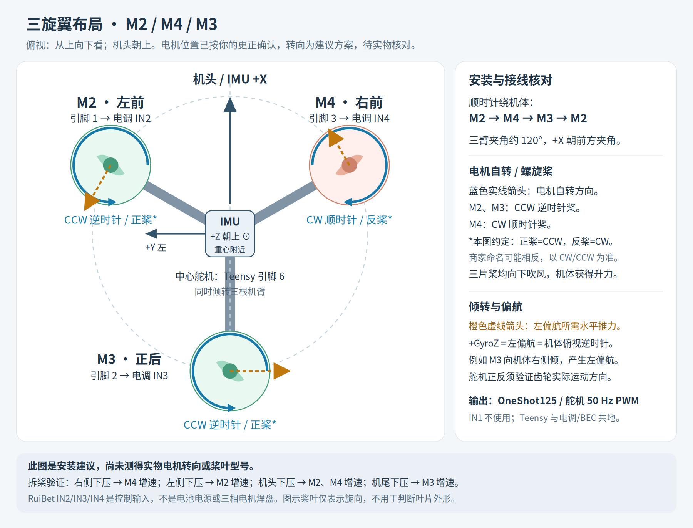

# 三旋翼与低速 Cyclone 旋转控制

## 2026-10-29：Yaw 标定、建模与 RemoteMCU

用户已确认普通三旋翼能够起飞，当前优先解决Yaw保持和舵机抖动。最新准备版在接收准备完成、链路有效、SA停机时，由CH6/S1直控中心舵机，保留逻辑50–130行程；失联／故障回中。CH6开机／重连先回中准备一次，再开始标定。

详见[角度定义、标定表、动力学及控制代码说明](YAW_MODEL_AND_CALIBRATION.md)：**M3推力轴顶端向机体右侧倾为正、竖直为零、向左倾为负**。已实现航向保持外环、率环PI、三臂倾转动力学及控制分配，但实机参数尚缺，默认飞行禁用，不能把源码／合成测试当成实飞验收。

首轮M3静态角度数据已按用户确认取反，并由三路共用，记录见[机构标定数据](servo-tilt-calibration.json)。插值竖直零位约1483.14µs，软件中位1504µs约−2.739°；保留实际中位输出。标定固件 `drehm-yaw-cal-20261029` 已通过RemoteMCU下载，三路角度表回读一致；16.10秒停机记录中主周期及最大周期500µs、最大工作281µs、超时0，三路电机命令为0。PWM命令1500µs时三路倾角估算均约−2.215°，即使完整动力模型未就绪也可显示；普通飞行倾角仍限制±30°，飞行仍禁用。详情见[标定版下载记录](yaw-calibration-upload-verification.json)。

默认USB使用RemoteMCU RMP，波形／状态／参数显示使用[应用Profile](remote-mcu/tricopter-yaw-calibration.json)。参数仅RAM应用，不在500µs主循环中写EEPROM。硬件准备好后已通过网关 `192.168.0.62` 下载 `drehm-yaw-model-20261029`，目标为 `teensy40-1881bf`；51.73秒停机记录中主循环及最大周期500µs、累计最大工作282µs、超时0，三路DShot命令始终为0。69项参数读取成功，CH6直控映射通过；闭环负载和实际倾角仍待验证。详情见[下载验证记录](yaw-upload-verification.json)。下文历史`?`／`c`查询适用于`DREHM_REMOTE_MCU=0`的历史或隔离台架配置。

## 2026-10-22 源码适配（待实机验收）

适用 `Versions/dRehmFlight_Teensy_BETA_1.3`，Teensy 4.0、MPU6050、TX16S / ELRS / CRSF、M2/M4/M3 三电机与中心联动倾转舵机。当前按**无机翼、IMU 靠近旋转中心**实现，最大指令转速 ±360°/s。安装机翼后的高速旋转与姿态闭环淡出未实现。

本节描述本次源码。后面的 2026-10-15 记录包含旧固件、旧台架状态和旧的临时手动偏航操作，仅作历史参考。最初软件交付只完成主机测试和编译；随后已按用户要求下载并进行停机状态核验，见下方记录。不能将历史硬件记录当成本次控制器的飞行验证结果。

### 2026-10-22 装桨地面测试后的舵机优化（源码已验证，待下载）

用户确认舵机摆动发生在装桨、机体仍在地面或被固定的条件；再次推油门时电机慢转已确认为动力电池没电。本次保留电机油门映射、输出范围及解锁/停机逻辑，针对偏航舵机的振动敏感和中位量化作调整。没有采集到此次带动力的GyroZ/舵机同步日志，不能把软件响应路径分析当作已确认的唯一振动原因。

- 偏航默认增益由P=0.30/I=0.05/D=0.00015改为P=0.12/I=0.03/D=0。保持偏航PI反馈和反扭矩补偿，默认取消易放大振动的偏航微分；横滚/俯仰增益不变。
- 在姿态换算后的偏航角速度上加12Hz一阶低通与连续±0.5°/s误差死区，舵机需求加8Hz低通，指令变化率限制为PWMServo逻辑60°/s。限速作用于连续目标，PWMServo的整数度输出仍有量化台阶；停机/失联/故障仍立即回中。
- 油门8%及以下偏航比例反馈为20%，8%至25%平滑增加到100%；积分从12%至25%渐入，12%以下不累积新积分，低于6%仍清除所有控制状态。这只是油门调度，不是离地检测；如果实测悬停油门低于25%，需复核渐入参数，不能假设低油门必然在地面。
- 舵机角度由直接截断改为四舍五入并加入0.15°切换滞回：89.999°与90.001°均输出中位90，避免原截断使中位附近89/90来回跳动。
- 幅度饱和或变化率受限时，不继续向受限方向累积偏航积分。松开偏航摇杆仍保留正常飞行所需的反扭矩补偿；SA停机或最低油门会复位积分与滤波状态。
- `c`快照新增`Y_FILT`（额外滤波后的偏航角速度）、`Y_GAIN`（当前低油门反馈系数）、`Y_REQ`（滤波/限幅前需求）、`Y_I`（积分状态）、`Y_SLEW`（变化率受限标记）。新实现位于`YawServoControl.h`，调参集中于`TricopterConfig.h`。

9个主机测试程序通过ASan/UBSan检查，正式Teensy 4.0固件编译成功。新增合成振动测试的输入是固定航向下120Hz/35Hz叠加角速度干扰；旧算法最大舵机需求偏移22.82°，新算法0.25°，50Hz采样的整数PWM指令没有切换。这里的角度均为软件逻辑量，数据是合成回归结果，不是实物测量。动力学回归现包含50Hz舵机整数度/滞回量化，在原18组条件下仍达到原有回归阈值；重复最低到最高油门也没有软件限幅残留。

后续用拆桨低油门先确认中位、偏航反馈方向和再次起转；装桨固定机架只作短时低油门观察，不通过长时间大油门约束测试判断空中偏航稳定性。固定/地面接触会改变闭环动力学，参考[ArduPilot地面振荡说明](https://ardupilot.org/copter/docs/common-ground-resonance.html)；微分噪声处理参考[PX4控制器说明](https://docs.px4.io/main/en/flight_stack/controller_diagrams)。要判断实际抑振效果，仍需在相同条件下记录`?`和`c`诊断，必要时检查机械间隙、桨叶平衡与IMU安装振动。

### 2026-10-22 上一版本下载与启动核验

已通过USB将正式DShot300固件下载至Teensy 4.0（上传端口`usb:120000`）。下载前确认油门1000、SA=2000、CH6=1503、ARM=0、三路DShot命令为0；下载后10秒收到175条诊断（88条主快照、87条控制快照）。`YAW_FB=1`、`MODE=0`、`IMU_OK=1`、`CTRL_FAULT=0`，有效遥控链路、READY=1、ARM=0，三路DShot始终为0，舵机命令保持逻辑90。观测期间主循环500µs、累计最大周期500µs、累计最大工作308µs、OVERRUN=0。

本次仅验证停机状态启动与诊断，未执行解锁、电机试转或实飞，未重新标定IMU。姿态读数约Roll 4.75–4.92°、Pitch 2.30–2.41°，未确认机架是否水平，不能据此重置偏置。固件哈希、源码哈希与观测范围保存于[下载验证记录](cyclone-upload-verification.json)。上文2kHz耗时只适用于本次停机条件，带动力和旋转中的实时性仍待验证。

### 遥控器操作与接收端约定

| 输入 | 原始接收通道约定 | 普通模式 | 旋转、减速模式 |
| --- | --- | --- | --- |
| 左摇杆上下 | CH3，最低1000 / 最高2000 | 控制推力 | 控制推力 |
| 右摇杆上下 | CH2，前推2000 / 后拉1000 | 按机头方向前后倾斜 | 按驾驶参考方向前后倾斜 |
| 右摇杆左右 | CH1，左1000 / 右2000 | 按机头方向左右倾斜 | 按驾驶参考方向左右倾斜 |
| 左摇杆左右 | CH4，左1000 / 右2000 | 左逆时针、右顺时针，控制机体偏航角速度 | 左逆时针、右顺时针，改变驾驶参考方向；不叠加实际自旋速度 |
| S1 旋钮 | CH6，左1000 / 右2000，中位1500 | 回中选择普通模式 | 左逆时针、右顺时针，控制持续自旋角速度 |
| SA | CH5，2000停机 / 1000解锁请求 | 停机优先 | 停机优先 |

烧录后的首次检查必须在拆桨条件下逐个核对原始通道、指令及执行器方向。尤其 CH2 的前推数值不能仅凭 AETR 名称判断；若与表格不同，应在遥控器反向或修改 `pitchDirection` 后重新检查。禁止把 CH1/CH2 混入 CH4/CH6。串口 `?` 的 CH1…CH6 仍打印原始 AETR 数值，控制器内部按 T/R/P/Y 排列，内部正偏航为左/逆时针。

油门控制总推力，横滚/俯仰控制倾角，没有定高、定位或地速闭环。回中代表倾角目标回零，不保证立即刹停平移。

### 普通模式与旋转模式

普通模式使用机头驾驶，CH4 控制实际航向变化率，CH4 回中目标为零角速度。舵机通过闭环抵消两逆一顺电机的反扭矩，**不要求舵机一直停在机械中位**；`yawFeedbackEnabled=true` 为当前闭环行为的诊断标志，不再提供关闭飞行偏航反馈的路径。

CH6 离中位超过50µs进入旋转模式；回到±30µs内开始退出。CH6 离中位30µs以外按剩余470µs连续映射到 ±360°/s。边界滞回避免模式抖动，外圈50µs以内不会从普通模式开始自旋。左右摇杆使用±20µs死区并重新缩放剩余行程。

进入旋转时，当前机头成为驾驶参考。机体真实航向继续改变；右摇杆经真实航向与驾驶参考的相位差变换，实现不随机体自旋转动的前后左右控制。CH4 只改变驾驶参考，最大±160°/s。无磁力计，驾驶参考是相对方向，长时间仍会漂移。

CH6 回中后，角速度指令以180°/s²降为零；实际航向变化率连续300ms低于15°/s，且指令已降到零，才进入参考对齐。随后用一秒平滑过渡到当前机头驾驶，不强制返回旋转前朝向。对齐期间CH4仍作用于驾驶参考，完成后恢复普通实际偏航控制；期间重新拨动CH6会连续返回旋转模式。旋钮跨过中位也会让角速度指令经过零速再反向。

### 姿态控制与配置

纯数学控制模块为 `CycloneControl.h`，姿态及坐标运算为 `FlightMath.h`，参数集中于 `TricopterConfig.h`，横滚/俯仰增益沿用主 sketch 的 `Kp/Ki/Kd` 参数，偏航默认值集中于 `TricopterConfig.h`。当前增益只是初始值，需要按实物调参。本控制器仅支持正立飞行，不支持倒飞或特技翻滚。

- MPU6050 改为±2000°/s，初始化读取回查量程。保留现有安装方向和2026-10-15的物理单位偏置；量程变化后必须重新检查静止残差，必要时重新标定。
- 四元数表示真实姿态；融合使用 forward/right/down，驾驶方向使用右横滚、前俯仰、左/逆时针偏航为正。真实航向由四元数得出，跨越±180°时用最短角差，不另建纯GyroZ积分器。
- 偏航反馈使用姿态转换后的航向变化率，而不是直接将机体系GyroZ当成航向变化率。
- 在驾驶参考坐标系中计算推力轴倾斜误差、阻尼与积分，再转换到机体系输出。阻尼消除驾驶参考转动，并投影去除绕推力轴的旋转，避免纯自旋产生虚假倾斜纠正。
- 普通倾角上限30°，旋转/减速/对齐时15°，以15°/s连续变化。对角摇杆按向量限幅。
- 全程保留横滚/俯仰姿态P/D反馈；仅降低高转速下的积分带宽，±360°/s时积分增益为正常的0.1倍（`spinTiltIntegralScale`）。积分状态随参考轴变换以保持物理纠正连续，没有高速闭环退出功能。
- 横滚/俯仰混控保留120°几何；饱和时整体缩放差动量，保留总推力和纠正方向，并抑制继续增加饱和的积分。
- 偏航默认使用PI反馈；若以后启用D，其微分作用于滤波后的测量值并另行低通。积分与舵机幅度/变化率限幅联动，允许持续的小量补偿反扭矩。舵机方向仍为-1，逻辑行程50–130（不是桨盘倾角）。
- 加速度明显偏离重力幅值（0.8–1.2g）时仅传播陀螺姿态，不用该加速度纠正重力方向。当前没有IMU偏心距离标定或离心加速度补偿；IMU必须尽量靠近旋转轴，轻微偏心造成的加速度仍可能落入重力门限，需要在实机验收中检查。

### 解锁、停机与故障恢复

上电/失联重连后，先油门低于1050、SA停机、CH6回到1470–1530，取得有效链路进入READY；随后在低油门和CH6回中时切SA请求解锁。非零自旋旋钮禁止解锁。低于1060油门复位控制积分与模式，舵机保持中位；DShot最低运行门限仍为1040。

正常固件中，SA停机或失联时电机停止、舵机回中。原先SA停机时CH6直接扫舵机的行为，只有显式设置 `fullRangeBenchTest=true` 才启用；该配置禁止所有飞行解锁，仅供拆桨和机械检查。

IMU短帧/读失败、零加速度帧、传感器原始值触及量程端点、无效四元数/融合输入、超过10ms的控制周期、航向奇异姿态或机体倒置会锁定控制故障并停机。恢复需要有效数据、SA停机、油门最低、CH6回中持续300ms；随后重新准备、解锁，不会仅因传感器恢复而继续飞行。MPU6050新增 `getMotion6Checked`，只有完整14字节读取才更新样本；I2C底层故障时的阻塞时长仍受Teensy Wire实现影响，不能把3ms软件读检查当作硬件总线超时上限。

### 诊断与验证

USB保持500000 baud，仅收到查询才输出，不等待读取方，每种快照最多20Hz：

- `?`：原始通道、链路、READY、ARM、舵机、电机、姿态及2kHz周期统计，兼容旧台架工具。
- `c`：`MODE`（0普通/1旋转/2减速/3对齐）、`IMU_OK`、`CTRL_FAULT`、`HEADING`、`REF`、`PHASE`、`YAW_DES`、`YAW_RATE`、`Y_PID`、`MIX_SCALE`、`TILT_MAX`及上述舵机优化诊断字段。角度为度，角速度为度/秒，航向及相位为[-180,180)。`MIX_SCALE`小于1表示电机差动输出饱和。停机/故障快照中的控制参考和目标会复位。

主机检查（不写入仓库构建产物）：

```sh
python3 tools/run_host_tests.py --sanitize
arduino-cli compile --fqbn teensy:avr:teensy40 --build-path /tmp/drehmflight-cyclone-build Versions/dRehmFlight_Teensy_BETA_1.3
```

`cyclone_control_test` 覆盖方向/死区、模式滞回、相位跨界、固定空间倾斜与推力轴自旋、参考转向、正反转斜坡、退出与重新进入、抗积分饱和、故障恢复和零梯度融合。`cyclone_dynamics_test` 是**未辨识的简化模型回归**：包含电机延迟、50Hz舵机采样、40/80/120ms舵机延迟、净偏航反扭矩、两种惯量比及正反90/180/360°/s。仿真通过不等于实机稳定性已验证。

2026-10-22 初版验证结果（舵机优化前）：8个主机测试程序全部通过 AddressSanitizer / UndefinedBehaviorSanitizer 检查；动力学回归覆盖18组惯量、速度与延迟组合（每组包含正转、反转和退出）。正式DShot300飞行配置、DShot300混合控制台架、DShot300单电机/M3方向台架、OneShot125台架、DShot600台架共5种Teensy 4.0配置均编译成功。编译仍有已有CRSF库架构标注、未使用标定变量及未启用TFMPlus代码的警告，未阻断构建。

待实机完成的验收顺序：

1. 拆桨核对通道、三电机位置/转向、舵机中位/方向/止挡，以及手动倾斜纠正方向；检查SA与实际失联停机、重连和CH6非零禁止解锁。
2. 静止检查新量程下IMU残差；有效链路、诊断读/不读、全部执行器运行时检查 `WORK_MAX_US<500`、`OVERRUN=0`。本次下载已核验停机且读取诊断时的2kHz周期；执行器运行、旋转及不读取诊断的条件仍待验证。
3. 普通悬停先验证CH4回中抑制自旋，再验证四轴操纵；稳态偏航速率目标≤5°/s，倾斜误差目标≤5°，记录舵机补偿及饱和情况。
4. 转速逐级试验±90、±180、±360°/s，验证双向姿态闭环和右摇杆方向；转速稳态误差目标≤max(目标的10%,10°/s)，中位倾斜误差目标≤5°。先在 `spinMaxDps` 设较低上限完成调参，再逐步升到360。
5. 验证旋转中CH4只改变驾驶参考、CH6回中减速与参考对齐、对齐中重新旋转，以及带动力的SA/失联保护。记录实际执行器延迟、振动和IMU偏心影响，再决定后续调整。


# 2026-10-15 历史配置与实机记录

适用代码：`Versions/dRehmFlight_Teensy_BETA_1.3`。2026-10-15 按实际机架描述适配。

当前板上已下载正式三旋翼 **DShot300** 固件，取消台架输出限幅与三秒自动停机。保留SA停机、ELRS失联与重连准备条件、DShot故障停机及2kHz角度控制。首次离地出现M3最高、M4其次、M2最低后，按用户要求重新标定当前位置水平零位，并临时设为CH4手动倾转、`yawFeedbackEnabled=false`（诊断`YAW_FB:0`），关闭陀螺仪偏航自动补偿。此前正式闭环镜像刷写后49条诊断确认 `PROTO:300 LINK:1 FS:0 READY:1 ARM:0`，三路DShot为0，已无 `BENCH`/`TIMEOUT` 字段；主循环及最大周期500µs、最大工作265µs、超时0。正式固件带动力失联验收和首次悬停尚未完成，不等同于已验证飞行稳定性。台架镜像仍可通过 [motor_bench](../tools/motor_bench/README.md)重新生成，其限幅与三秒保护不属于正式固件。



## 已确认的结构

- 从上往下看，M2 左前、M4 右前、M3 正后；顺时针依次 M2 → M4 → M3。
- 三臂约等长、互成 120°。IMU +X 朝机头，指向 M2 与 M4 中间；按仓库坐标，+Y 向左、+Z 向上，元件面朝上。
- 一个中心舵机同时倾转三根机臂，用于偏航。此版为普通姿态悬停的三旋翼混控；高速自旋的控制器切换/定向控制尚未实现。

## 信号线与建议桨叶

| 位置 | 实物电机/电调编号 | Teensy 数字引脚 | 电调控制输入 | 建议自转（俯视） | 配套桨 |
| --- | --- | --- | --- | --- | --- |
| 左前 | M2 | 1 | IN2 | CCW 逆时针 | CCW 桨（本图称正桨） |
| 右前 | M4 | 3 | IN4 | CW 顺时针 | CW 桨（本图称反桨） |
| 正后 | M3 | 2 | IN3 | CCW 逆时针 | CCW 桨（本图称正桨） |
| 中心倾转舵机 | Servo1 | 6 | 舵机信号 | 齿轮方向需实测 | 不适用 |

单电机实测进度：M2 已由用户确认位于左前方、俯视逆时针，另外两路静止；M3 已确认正后方，软件反转、保存后已通过掉电复测，俯视逆时针；M4已确认右前方、俯视顺时针，串口证实仅M4输出运行值。

上述转向已逐路实测确认；电机位置编号本身不能决定转向。正常飞行固件不发送方向设置命令；本次曾用独立台架镜像设置并保存M3电调方向，且已通过掉电复测。电调方向设置或交换任意两条电机相线可以改变实际方向。厂家“正/反/R”命名未必一致，最终以 CW/CCW 对应、向下吹风、机体获得向上推力为准。图中示意叶片并非实际桨叶截面或安装照片。

RuiBet 的 IN2、IN3、IN4 是小信号控制输入，编号分别对应四合一电调上的 MOTOR2、MOTOR3、MOTOR4 三相输出。IN1 保持不接。Teensy、电调信号地、舵机 BEC 地必须共地；电调 VCC 是动力电池电压，不得接入 Teensy 3.3 V/5 V 电源脚。舵机使用独立、足够电流的 BEC，电压在其手册 4.8–6.8 V 范围内。

电机协议默认 DShot300（`TricopterConfig.h` 中 `DREHM_ESC_DSHOT_RATE=300000`），三路并行、2 kHz更新；未解锁、SA停机、失联及输出故障均发送0，运行值48–2047。内部125–250缩放量仍沿用原控制器，不是DShot线上脉宽。设置为0可编译旧OneShot125分支，600000可选择DShot600；当前实物已验证的是DShot300。舵机独立硬件 PWM 为 50 Hz。厂商参数表标注 RuiBet 60A/65A 使用 BLHeli_S J_H_15_REV16_7；厂商也提供 Bluejay 固件。**实际若已刷 Bluejay，它只接受 DShot，OneShot125 不能驱动它，须使用支持的DShot配置。** 用户已报告接入电调信号线并拆下螺旋桨，DShot300协议与三个通道的起转已验证；实物位置和转向已按上表逐路核对。

## 混控

令 T 为油门、R 为横滚 PID、P 为俯仰 PID，输出为：

```text
M2 = T + 0.8660254 R - 0.5 P   左前
M4 = T - 0.8660254 R - 0.5 P   右前
M3 = T                 + P    正后
```

系数来自等长 120° 机臂几何，在输出未饱和时横滚/俯仰互不耦合，三个输出的和为 3T。沿用原项目逐电机限幅；饱和时会损失控制裕量，原 PID 参数仍需地面验证与后续调参。偏航不加入电机差动，而送入中心倾转舵机；当前临时手动模式将CH4直接映射至舵机，GyroZ不参与舵机指令。

遥控器 AETR：CH1 横滚、CH2 俯仰、CH3 油门、CH4 偏航、CH5 SA 停机、CH6 S1 台架测试。仓库的 +Z 向上，正 GyroZ 是俯视逆时针/左偏航；原文档要求偏航左 2000、右 1000。针对用户先前确认的标准 AETR 左 1000、右 2000，内部将 CH4 转成 `3000 - 原始CH4`，串口 CH1..6 仍打印原始值。

## 舵机测试与闭环

配置集中在 `TricopterConfig.h`：

- `fullRangeBenchTest=false`：满行程台架测试已完成，当前 S1 使用配置的舵机轴约 ±60° 范围。需要再次检查满行程时，临时改为 `true`，并只在拆桨、舵机信号线断开的条件下运行。
- `servoMinUs=512`、`servoMaxUs=2500`：PWMServo 以 16 µs 量化端点，实际范围约 512–2496 µs。USB 中 `S1_US` 是按库端点计算的估计值，尚未经示波器测量。
- `servoCenterDeg=90`：软件中位，脉宽约 1504 µs。`S1` 是 PWMServo 的 0–180 逻辑量，不能直接当作 270° 舵机轴的物理角度。真实桨盘倾角还受齿轮比、安装零位影响。
- `yawServoLimitDeg=40`：S1 台架控制和飞行偏航闭环均限制在 PWMServo 逻辑 50–130；对完整 270° 的线性舵机，对应轴角约 ±60°。中位保持逻辑 90，估算脉宽范围约 1063–1944 µs，中位约 1504 µs。偏航 PID 增益不变，只扩大输出限幅。此角度并非机臂倾角的标定值，安装零位、齿轮比和机械止挡仍需实物检查。
- `yawServoDirection=-1`：实测CH6=1653、逻辑S1=102（估算1636 µs）时，M3向左倾；中位为逻辑90（约1504 µs），三轴竖直。增大脉宽产生M3左倾/顺时针偏航力矩，因此正偏航PID须减小脉宽，使M3右倾并产生逆时针力矩。已据此反转软件符号；后续手动偏航反馈复测结果见验证记录。

`yawFeedbackEnabled=false` 是当前临时配置。SA=1000解锁后，CH4回中时舵机保持逻辑90（约1504µs）；左偏航指令令M3向右倾，右偏航指令令M3向左倾。机体转动不会自动改变舵机指令。SA=2000时S1控制保持原行为；失联仍回中并停机。两逆一顺的反扭矩需由驾驶员用CH4纠正，关闭反馈不代表解决了不均匀离地。恢复闭环时将`TricopterConfig.h`中的`yawFeedbackEnabled`设为`true`并重新编译下载。

状态行为：

| 状态 | 电机 | 舵机 |
| --- | --- | --- |
| 上电、无有效链路、失联 | 停机 | 中位 |
| 有效链路、CH5≥1500 | 停机 | CH6/S1 控制舵机轴约 ±60°（当前配置） |
| CH5<1500，未满足解锁条件 | 停机 | 中位 |
| 已解锁 | 油门+横滚/俯仰混控 | 当前CH4手动倾转，逻辑限幅50–130；恢复yawFeedbackEnabled=true后使用偏航PID |

上电/重连后，先油门最低、SA=2000，收到有效链路才能 READY=1。满行程测试配置下，S1/CH6 还需回到 1460–1540 才允许随后以 SA=1000、低油门解锁。旋钮在飞行中不接管舵机。

本轮满行程台架测试已完成：在 SA=2000、油门最低、舵机控制信号线断开的情况下，实测 CH6=1000 对应 `S1=0, S1_US=512`，CH6=2000 对应 `S1=180, S1_US=2496`；中位约为 1504 µs。这里的脉宽由 PWMServo 配置推算，未用示波器测量。配置已恢复 `fullRangeBenchTest=false`；随后按用户要求，CH6/S1 与飞行偏航限幅均扩大为舵机轴约 ±60°（逻辑 50–130）。以后如需再次扫满行程，务必拆桨并断开舵机控制线，防止机构止挡导致舵机堵转。

## 拆桨验收

1. 电机位置、小信号线及实测转向已与上图核对；M3方向保存后通过掉电复测。更改接线或电调设置后须重新检查。
2. 当前板上为正式DShot300配置，已取消台架限幅与三秒停机；每次试转均由SA或失联保护停机。不得误刷带BENCH标记的镜像用于飞行。
3. 保持 `fullRangeBenchTest=false`，确认舵机中位时三桨盘轴竖直向上，并缓慢检查当前约 ±60° 舵机轴行程不会碰机械止挡；解锁前将 S1 回中。
4. 拆下所有桨，使用[单电机台架模式](../tools/motor_bench/README.md)逐个确认实际电机位置与转向。该模式由USB在停机时选择电机，再用SA和低油门试转；正常飞行模式抬油门仍会控制三个电机。
5. 低油门解锁并适当抬油门，右边下压应 M4 增速；左边下压应 M2 增速；机头下压应 M2/M4 增速；机尾下压应 M3 增速。读数位于输出饱和区或油门最低时不能可靠比较。
6. 向左转动机体（GyroZ>0）应使舵机产生右偏航的水平推力；向右转动应产生左偏航推力。方向相反会形成正反馈，需修改 `yawServoDirection` 后重测。
7. SA=2000 必须停机；关闭遥控器也必须停机并使舵机回中。已完成当前安装姿态下的 IMU 静止水平标定；当前验证进度见下表；带动力的闭环响应和实际电机失联停转仍需实机验收。

## 当前闭环方向验证进度

以下姿态测试均在电调动力断开、拆桨条件下完成。`M*_S` 是限幅前的混控需求，不是实测转速。

| 项目 | 已观察结果 | 结论 |
| --- | --- | --- |
| 右侧M4压低 | Roll为正，M4需求高于M2 | 横滚纠正方向正确 |
| 左侧M2压低 | Roll为负，M2需求高于M4 | 横滚纠正方向正确 |
| 机头压低 | Pitch为正，M2/M4需求高于M3 | 俯仰纠正方向正确 |
| 机尾M3压低 | Pitch为负，M3需求高于M2/M4 | 俯仰纠正方向正确 |
| 舵机中位 | 机架水平时三个电机轴均竖直 | 用户实物确认 |
| 小幅倾转 | 三臂同步、无卡滞；增大脉宽时M3左倾 | 已据此设置偏航符号为-1 |
| 手动向左/逆时针转机体 | M3左倾，停止后回中 | 产生右偏航纠正力矩，反馈方向正确 |
| CH4驾驶方向 | 左指令使M3右倾；用户确认左右与预期相符 | 驾驶方向正确 |
| 低油门解锁后关闭遥控器 | FS=1、READY=0、ARM=0、D2/D3/D4=0、S1=90；用户确认中位 | 失联保护软件输出正确，未接电调动力 |
| 遥控重连 | SA仍为1000时READY=0、ARM=0；SA=2000重连后READY=1、ARM=0、三路DShot为0 | 重连未自动解锁，安全准备状态恢复 |
| 偏航修正后水平低油门试转 | 三个电机正常起转，CH3最高1098，D2/D3/D4最大223/239/239 | 主循环500µs、工作最大297µs，无超时或DShot故障 |
| 右侧压低约11°、固定机架、低油门 | M4先于M2起转；运行指令平均D4=150、D2=75 | 横滚纠正方向通过；未测转速或带桨姿态稳定性 |
| 保持低油门时SA切回2000 | CH3=1062、ARM=0、TIMEOUT=0、三路DShot=0；用户确认立即停转 | SA实际停机通过，未依赖三秒保护 |
| 机头压低约11°、固定机架、低油门 | M2/M4先于M3起转；运行指令平均D2/D4约180、D3约112 | 俯仰纠正方向通过；未测转速或带桨姿态稳定性 |

上述手动偏航采样中，GyroZ为正时平均Y_PID=-0.0885、S1=105.6；GyroZ为负时平均Y_PID=+0.0549、S1=79.6。主循环及最大周期均为500µs，最大工作时间297µs，超时、串口溢出及DShot故障计数均为0。只在收到USB查询时输出诊断。关闭遥控器后先触发FS保护、退出解锁，随后LINK降为0；不能用主机采样时间推算遥控关机到保护触发的准确延迟。CH4左右驾驶指令已采集：左指令平均CH4=1415、Y_PID=+0.0813、S1=74.8；右指令平均CH4=1601、Y_PID=-0.0980、S1=107.1，符合已测连杆方向。用户确认驾驶倾转与上述预期相符，明确报告CH4向左时M3向右倾。水平起转试验中，电机命令在油门先回最低时归零，之后三秒保护锁定、SA=2000复位；随后专门复测已通过：SA切回2000时CH3仍为1062、TIMEOUT=0、ARM=0，三路DShot归零，用户确认立即停转。右侧压低的低油门实际起转响应已确认；俯仰机头压低的低油门实际起转响应也已确认；用户已确认S1两端安全，串口采集到CH6=1000/2000对应逻辑50/130，估算1063/1944µs；实际电机失联停转、带桨稳定性及飞行调参仍未完成。最新累计最大周期503µs、最大工作298µs，OVERRUN=0，DShot故障、引脚回读错误及串口溢出均为0。

## 首次离地后的重新标定与临时手动偏航

用户更正首次离地现象为：正后M3最高、右前M4其次、左前M2最低。原因未确认；不能将重新标定或关闭偏航反馈视作已经解决推力/重心问题。

在用户确认断电、拆桨、当前位置机架水平静止后，再次用无执行器输出的标定镜像采集12,000组数据；加速度标准差最大0.00417g、陀螺仪标准差最大0.1283°/s，前后半段稳定。新偏置已写入源码，旧标定保存于[imu-calibration.json](imu-calibration.json)的`previous_calibrations`中。

新的正常固件已下载，实机10秒97条查询诊断确认`YAW_FB=0`、有效链路、SA=2000、ARM=0、三路DShot=0。后半段横滚均值-0.0097°、俯仰均值0.0009°，两轴范围约±0.06°；R_PID/P_PID均值约0.00002。主循环及最大周期500µs、最大工作273µs、超时0。主机检查覆盖手动偏航中位、方向、限幅以及PID极值不影响CH4中位指令；本次刷写后尚未实物复查解锁时的舵机行为，也尚未重试离地。

## IMU 静止水平标定

2026-10-15，用户确认拆桨、电调动力电池断开、机架水平静止后，使用临时标定固件采集 MPU6050 的 12,000 组数据，样本之间延时 1 ms。标定程序不产生电机脉冲或舵机 PWM；采集结果、标准差、前后半段均值和温度保存于 [imu-calibration.json](imu-calibration.json)。

当前重新标定后写入正常固件的安装水平偏置如下（初次标定已保留在JSON历史记录中），加速度单位为 g，陀螺仪单位为 °/s：

| 参数 | 值 |
| --- | ---: |
| AccErrorX | 0.04727974 |
| AccErrorY | -0.02008748 |
| AccErrorZ | -0.07755037 |
| GyroErrorX | -3.01755089 |
| GyroErrorY | 0.67561323 |
| GyroErrorZ | -0.54787786 |

加速度采样标准差最大约 0.0041 g，陀螺仪最大约 0.120 °/s，前后半段均值稳定。原始静止 Z 轴约为 0.922 g，本次按原项目方法将该姿态的加速度均值校正为 (0, 0, 1) g；这是单姿态偏置和安装水平校正，未验证六面比例系数。重新安装 IMU 或改变其安装角度后应重做标定。正常固件保持 `calculate_IMU_error()` 调用被注释，固定参数校正沿用现有运算，不在高速主循环中增加采样或等待。

正常固件已重新编译下载，随后 10 秒采集 201 条诊断，后半段横滚均值 -0.012°、俯仰均值 0.007°，三轴陀螺仪平均残差绝对值均小于 0.014 °/s。有效遥控链路下 `ARM=0`，三路电机命令均为 120 µs；主循环与最大周期均为 500 µs，最大工作时间 325 µs，超时计数为 0。此记录未包含动力上电或电机试转。

随后用户确认电调动力已上电、螺旋桨已拆下、三个电机保持停止；5 秒采集 101 条诊断，`LINK=1 FS=0 READY=1 ARM=0`、CH3=1000、CH5=2000，三路电机命令均为 120 µs，横滚约 0.67°、俯仰约 -0.15°。主循环与最大周期均为 500 µs，最大工作时间 322 µs，超时计数为 0。该步骤验证了上电后的停机状态；尚不能据此确认电调协议、实际转向或失联时实际停转。

后续解锁与油门响应测试：软件解锁成功，最低油门时三路命令为 125 µs；实际试验中 CH3 最高达到 1758，超过预定的 1050–1100 试验区间，三路命令最高为 218/219/221 µs，用户报告三个电机均未转动。SA 回到 2000 后，ARM=0、三路命令回到 120 µs。该次主循环最大周期 500 µs、最大工作时间 425 µs、超时计数为 0。电调实际协议与信号接口仍待确认，不能继续靠增加油门排查。

断开电调动力和信号线后使用 [OneShotLoopback 仪表](../tools/OneShotLoopback/README.md)检查引脚 1/2/3。初始回读跳线错位；用户重新接成 1→14、2→15、3→16 后，五组 120–250 µs 脉宽测试全部通过，实际回读偏差约 0–1 µs、周期 499–501 µs。此结果确认了三路 GPIO 输出及当前回读跳线；原电调线末端和实际电调协议尚未验证。临时仪表已退出，恢复正常的已标定固件。详细记录保存于 [motor-bench-verification.json](motor-bench-verification.json)。

用户随后拔掉回读跳线并接回电调信号。因上次手动油门超过试验目标，本轮使用仓库外生成的有限幅台架固件，运行命令限制为 125–137 µs；首次油门大于 1040 后计时三秒，超时输出停机值120并锁定，须 SA=2000 复位。限幅、超时锁定、开关复位及计时器回绕主机检查通过。刷写后遥控有效，SA=2000、ARM=0、TIMEOUT=0，三路命令均为120，主循环500 µs、最大工作327 µs、超时计数0。此时等待本轮实际电机试转结果。

## 保持 2 kHz 与环境复现

```sh
arduino-cli lib install CRSFforArduino@2025.12.11
python3 tools/configure_crsf_realtime.py
arduino-cli compile --fqbn teensy:avr:teensy40 Versions/dRehmFlight_Teensy_BETA_1.3
arduino-cli upload --fqbn teensy:avr:teensy40 --port usb3/3-2/3-2.4 Versions/dRehmFlight_Teensy_BETA_1.3
```

首次安装或重装 CRSF 库后需要运行配置脚本，将未使用的发射遥测关闭，以免库内 UART flush 等待发送。接收通道和链路统计继续有效。源码会在编译时检查这个设置。

`loopRate(2000)` 保持不变，混控只增加固定次数的乘加和条件判断。电机仅输出 M2/M3/M4 三路，其他输出保持低电平。USB 诊断为 20 Hz，缓冲区不足时丢弃整行；不等待串口读取。诊断报告 `LOOP_US`、`LOOP_MAX_US`、`WORK_MAX_US`、`OVERRUN`，其中 MAX 和超时计数是自上电累计值。

2026-10-15 已编译并刷入 Teensy 4.0，主机混控/限幅/解锁条件测试通过。实机先在遥控断开、舵机及电调控制线断开、机架倾斜靠墙的条件下验证：正常读取 3 秒、暂停 USB 读取 4 秒、恢复读取 3 秒，共取得 158 条诊断。`LINK=0 FS=1 READY=0 ARM=0`，舵机命令保持中位 `S1=90`（估算 1504 µs），三个电机命令均为停机值 120 µs；`LOOP_US=500`、`LOOP_MAX_US=500`、`WORK_MAX_US=321`、`OVERRUN=0`。暂停读取未造成该次运行中记录的主循环超时。

上述结果只覆盖失联停机和 USB 暂停读取条件；有效 ELRS 链路、高油门输出及实际电机/舵机负载仍需分别验证。倾斜机架未做 IMU 水平标定，也未将估算脉宽当作示波器实测值。

MPU6050 无磁力计，已经将其磁场输入显式置零，避免原代码未初始化的磁场变量误入九轴融合。

主机数学验证：

```sh
g++ -std=c++11 -Wall -Wextra -Werror tests/tricopter_mixer_test.cpp -o /tmp/tricopter_mixer_test
/tmp/tricopter_mixer_test
```

## 原始资料

- [作者 Cyclone 博客及评论中的三旋翼混控建议](https://hackaday.io/project/186410-the-cyclone-rotor-ufo-drone)：中心舵机同时倾转三臂；普通三旋翼混控与高速自旋控制是不同阶段。
- 仓库 `dRehmFlight VTOL Documentation.pdf` 第 6.1、6.2、9.8 节：IMU 坐标、原始遥控方向、拆桨检查混控方法。
- [JHEMCU RuiBet 60/65A 官方产品页](https://jhemcu.com/e_productshow/?82-JHEMCU-RUIBET-6065A-3-6S-DSHOT600-BLHELI_S-4IN1-ESC-82.html=)。
- [JHEMCU 官方参数表、接线图及 BLHeli_S/Bluejay 固件](https://github.com/jhemcu/FC-ESC-Firmware/tree/main/Ruibet%2060A%2065A%E5%9B%9B%E5%90%88%E4%B8%80%E7%94%B5%E8%B0%83)。
- [Bluejay 官方支持协议](https://github.com/bird-sanctuary/bluejay)：DShot300/600。

本文件记录适配与台架验证方法；实际桨叶、电机方向、齿轮方向、IMU 标定与实机闭环尚需按实物验收，当前固件已经刷入正常运行配置，但不能视作已验证飞行稳定性。
